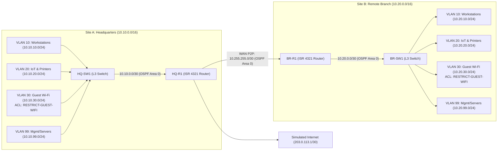

# Lab 1 (Cisco CCNA): Explain It Simply & Interview Guide

## 1. Your 30-Second Plain-English Pitch (For Interviews)
> *"I designed a dual-site corporate network connecting a Headquarters (`Site A`) and a Remote Branch Office (`Site B`) over a routed OSPF point-to-point WAN link. At each site, a Layer 3 switch segments traffic into four separate VLANs—Workstations, IoT/Printers, Guest Wi-Fi, and Server Management. To enforce zero-trust security, I applied an inbound extended ACL on the Guest Wi-Fi gateway so guests can reach the internet and DNS, but are completely blocked from touching internal corporate subnets or router/switch management interfaces. Finally, I hardened all administrative VTY lines to accept only SSHv2 with scrypt password hashing and an admin-only access list."*

---

## 2. Visual Architecture Diagram

---

## 3. Component-by-Component Breakdown (What Every Piece Does)

| File / Feature | What It Is in Plain English | Why Hiring Managers Care |
| :--- | :--- | :--- |
| [`configs/site-a-hq.txt`](file:///c:/Users/adryd/OneDrive/Documents/Adam/Work/Home%20Lab%20Templates%20Portfolio/01-ccna-corporate-network/configs/site-a-hq.txt) | Full Cisco IOS config for Headquarters Router (`HQ-R1`) and Layer 3 Switch (`HQ-SW1`). | Proves you can configure inter-VLAN routing using Layer 3 SVIs (`interface Vlan10/20/30/99`) instead of bottlenecking a router-on-a-stick. |
| [`configs/site-b-branch.txt`](file:///c:/Users/adryd/OneDrive/Documents/Adam/Work/Home%20Lab%20Templates%20Portfolio/01-ccna-corporate-network/configs/site-b-branch.txt) | Full Cisco IOS config for the Branch Office Router (`BR-R1`) and Layer 3 Switch (`BR-SW1`). | Demonstrates repeatable multi-site IP addressing (`10.10.x.x` at HQ, `10.20.x.x` at Branch) and dynamic route exchange via OSPF Area 0. |
| `ip ospf network point-to-point` | Tells OSPF that the transit links only connect 2 devices, skipping the 40-second DR/BDR election timer. | Shows real-world NOC optimization—links converge almost instantly after a cable flap. |
| `RESTRICT-GUEST-WIFI` (Extended ACL) | Applied `in` on `interface Vlan30`. Blocks Guest Wi-Fi from `10.0.0.0/8`, `172.16.0.0/12`, and `192.168.0.0/16` while allowing internet egress. | Putting the Extended ACL inbound on `Vlan30` drops unauthorized guest packets at the very first hop before they ever cross the switch backplane. |
| `VTY-ADMIN-ALLOW` + `transport input ssh` | Disables unencrypted Telnet and restricts who can even attempt an SSH handshake to Corporate & Management VLANs (`10` and `99`). | Defense-in-depth: even if someone on Guest Wi-Fi stole an admin password, the VTY control plane rejects their TCP connection immediately. |

---

## 4. Top 3 Technical Interview Questions & Ready Answers

1. **Q: Why did you do inter-VLAN routing on the Catalyst 3650 Layer 3 Switch (`HQ-SW1`) instead of on the edge router (`HQ-R1`)?**
   - **A:** *"Routing between VLANs locally on the Layer 3 switch uses hardware ASICs at wire speed (`ip routing` + SVIs). If I used router-on-a-stick on `HQ-R1`, every local file transfer between a workstation in VLAN 10 and a printer in VLAN 20 would have to hair-pin up and down a single uplink cable to the router."*
2. **Q: Why did you configure `passive-interface default` under `router ospf 1` on the switches?**
   - **A:** *"For security and efficiency. Without `passive-interface default`, the switch would send OSPF Hello packets out of every access port to end-user PCs and Guest Wi-Fi devices, allowing a rogue laptop to form an OSPF adjacency and inject fake routes. I set all ports passive by default and only enabled OSPF on the routed uplink (`GigabitEthernet1/0/1`)."*
3. **Q: Where did you place the `RESTRICT-GUEST-WIFI` extended ACL and why?**
   - **A:** *"Cisco best practice is to place Extended ACLs as close to the traffic source as possible. Applying `ip access-group RESTRICT-GUEST-WIFI in` directly on `interface Vlan30` drops unauthorized guest packets immediately at their default gateway before they can traverse OSPF or reach other VLANs."*

---

## 5. Quick 10-Minute Review Checklist
- **Sun–Wed Evening (5-Minute Bite-Sized Check):**
  1. Run [`validate-lab.ps1`](file:///c:/Users/adryd/OneDrive/Documents/Adam/Work/Home%20Lab%20Templates%20Portfolio/01-ccna-corporate-network/validate-lab.ps1) in PowerShell to see all 7 automated compliance checks pass.
  2. Read the **30-Second Pitch** and **3 Interview Q&As** above once out loud.
- **Thu–Sat Off-Day (Optional Hands-On Packet Tracer Drill):**
  1. Paste [`configs/site-a-hq.txt`](file:///c:/Users/adryd/OneDrive/Documents/Adam/Work/Home%20Lab%20Templates%20Portfolio/01-ccna-corporate-network/configs/site-a-hq.txt) and [`configs/site-b-branch.txt`](file:///c:/Users/adryd/OneDrive/Documents/Adam/Work/Home%20Lab%20Templates%20Portfolio/01-ccna-corporate-network/configs/site-b-branch.txt) into Cisco Packet Tracer.
  2. Run `show ip ospf neighbor` and `show access-lists RESTRICT-GUEST-WIFI` to capture screenshots if desired.
