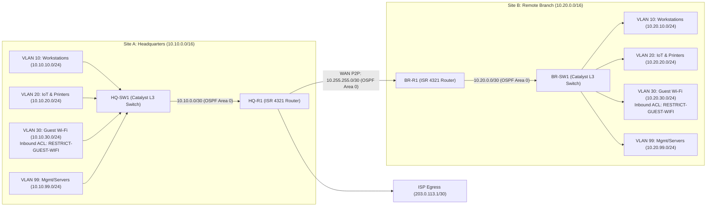

# Module 01 (Cisco CCNA): Enterprise Dual-Site OSPF WAN & L3 VLAN Segmentation

**Required Notice:** Copyright (c) 2026 Adam Dryden (`Phlotonic`) — Dual-Licensed under PolyForm Noncommercial 1.0.0 & Commercial License.

## 1. Executive Architecture Summary
This module implements a dual-site corporate Wide Area Network (WAN) connecting **Site A (Headquarters)** and **Site B (Remote Branch Office)** over a routed OSPF Area 0 point-to-point transit link. At each site, a Cisco Catalyst Layer 3 Multilayer Switch segments campus traffic across four Switched Virtual Interfaces (SVIs)—Corporate Workstations (`VLAN 10`), IoT & Printers (`VLAN 20`), Guest Wi-Fi (`VLAN 30`), and Infrastructure Management (`VLAN 99`). Inbound extended Access Control Lists (`RESTRICT-GUEST-WIFI`) isolate Guest Wi-Fi traffic from all internal RFC1918 subnets and management planes while permitting external DNS and internet egress. Administrative access is restricted to SSHv2 (`transport input ssh`) protected by scrypt secret hashing and control-plane ACLs (`VTY-ADMIN-ALLOW`).

---

## 2. Network Topology & Routing Architecture



---

## 3. Component & Configuration Specification

| Artifact / Control | Functional Role | Production Engineering Rationale |
| :--- | :--- | :--- |
| [`configs/site-a-hq.txt`](./configs/site-a-hq.txt) | Cisco IOS running configuration for Headquarters Router (`HQ-R1`) and L3 Switch (`HQ-SW1`). | Performs wire-speed local inter-VLAN routing in hardware ASICs via Layer 3 SVIs (`interface Vlan10/20/30/99`), avoiding router-on-a-stick uplink congestion. |
| [`configs/site-b-branch.txt`](./configs/site-b-branch.txt) | Cisco IOS running configuration for Branch Router (`BR-R1`) and L3 Switch (`BR-SW1`). | Enforces deterministic IP addressing (`10.10.x.x` at HQ, `10.20.x.x` at Branch) and dynamic route exchange over OSPF Process 1 Area 0. |
| `ip ospf network point-to-point` | OSPF interface network type on transit uplinks (`/30`). | Eliminates the 40-second Designated Router (DR/BDR) election wait timer on two-node links for sub-second OSPF convergence. |
| `RESTRICT-GUEST-WIFI` | Extended IPv4 ACL applied inbound on `interface Vlan30`. | Drops unauthorized Guest packets targeting `10.0.0.0/8`, `172.16.0.0/12`, and `192.168.0.0/16` at the first Layer 3 hop before crossing the switch backplane. |
| `VTY-ADMIN-ALLOW` + `transport input ssh` | Control-plane access class and SSHv2 enforcement on `line vty 0 15`. | Disables cleartext Telnet and rejects TCP management handshakes from non-administrative VLANs at the control plane. |

---

## 4. Key Architectural Design Decisions

1. **Why is inter-VLAN routing performed on the Catalyst 3650 Layer 3 Switch (`HQ-SW1`) rather than the edge router (`HQ-R1`)?**
   - Routing between local VLANs on the Layer 3 switch leverages hardware ASICs (`ip routing` + SVIs) at line rate, reserving the `10.10.0.0/30` routed uplink to `HQ-R1` strictly for cross-site WAN and internet egress traffic.
2. **Why is `passive-interface default` enforced under `router ospf 1` on the switches?**
   - Suppressing OSPF Hello packets on end-user access ports prevents unauthorized endpoints in Workstation or Guest VLANs from forming rogue OSPF adjacencies and injecting malicious routes. OSPF is enabled exclusively on the `/30` routed transit uplink (`GigabitEthernet1/0/1`).
3. **Why is `RESTRICT-GUEST-WIFI` applied inbound on `interface Vlan30`?**
   - Extended ACLs should be placed as close to the traffic source as possible so unauthorized Guest Wi-Fi traffic is dropped immediately at its default gateway SVI without consuming internal routing resources.

---

## 5. Deployment & Verification Runbook

```powershell
# 1. Render parameterized configurations from template-variables.json
powershell -NoProfile -ExecutionPolicy Bypass -File .\render-template.ps1

# 2. Execute automated security & routing compliance validation
powershell -NoProfile -ExecutionPolicy Bypass -File .\validate-lab.ps1
```

### Cisco IOS CLI Verification Commands
```ios
show ip ospf neighbor
show ip route ospf
show access-lists RESTRICT-GUEST-WIFI
show ip ssh
ssh -l netadmin 10.20.99.1
```
