# Lab 2 (CompTIA Security+): Explain It Simply & Interview Guide

## 1. Your 30-Second Plain-English Pitch (For Interviews & Clients)
> *"Standard Windows Event Logs miss critical kernel-level attack details, so I built a full SOC detection pipeline pairing **Microsoft Sysmon** on a Windows endpoint with a **Wazuh SIEM** server on Ubuntu. I wrote three custom XML detection rules mapped to **MITRE ATT&CK**—catching obfuscated PowerShell execution (`T1059.001`), LSASS memory credential dumping (`T1003.001`), and Registry Run key persistence (`T1547.001`). I then fired live adversary simulations using **Atomic Red Team** to prove the alerts trigger in real time, and documented the full containment and Credential Guard hardening playbook in a formal SOC Incident Triage Report."*

---

## 2. Visual Architecture Diagram

```mermaid
flowchart LR
    subgraph Endpoint["Monitored Windows Endpoint (WKSTN-FIN-04)"]
        ART["Atomic Red Team<br/>(T1059.001, T1003.001, T1547.001)"] --> Kernel["Windows Kernel / Registry / LSASS"]
        Kernel --> Sysmon["Sysmon64 Service<br/>(Event IDs 1, 10, 13)"]
        Sysmon --> WazuhAgent["Wazuh Agent (ossec.conf)<br/>EventChannel Forwarder"]
    end

    WazuhAgent -- "Encrypted TCP 1514" --> WazuhServer["Wazuh SIEM Server (Ubuntu 24.04)"]

    subgraph SIEM["Wazuh Detection & Response Plane"]
        WazuhServer --> Rules["local_rules.xml<br/>Rules 100101, 100102, 100103"]
        Rules --> Dashboard["MITRE ATT&CK Alert Dashboard"]
        Dashboard --> Report["INC-2026-1104 Triage Report &<br/>Containment Playbook"]
    end
```

---

## 3. Component-by-Component Breakdown

| File | What It Does in Plain English | Why Hiring Managers & Clients Care |
| :--- | :--- | :--- |
| [`deploy-soc.sh`](./deploy-soc.sh) & [`install-sysmon-agent.ps1`](./install-sysmon-agent.ps1) | Installs the Wazuh SIEM server on Linux and configures Windows Sysmon + Wazuh Agent `eventchannel` ingestion. | Shows you know how to bridge the visibility gap between raw endpoint processes and centralized SIEM correlation. |
| [`rules/local_rules.xml`](./rules/local_rules.xml) | Custom PCRE2 regex detection rules (`100101`, `100102`, `100103`) mapped to MITRE ATT&CK IDs. | Proves you don't just click buttons in a SIEM—you write custom detection engineering rules with low false positives. |
| [`run-atomic-tests.ps1`](./run-atomic-tests.ps1) | Executes safe, repeatable Red Canary **Atomic Red Team** tests and cleans up persistence artifacts afterward. | Demonstrates "Purple Team" validation: testing your own detections against real attacker techniques. |
| [`reports/INC-2026-1104-Triage-Report.md`](./reports/INC-2026-1104-Triage-Report.md) | Executive incident report detailing timeline, Sysmon evidence, and 0–30 minute network + identity containment. | In SOC interviews, communication and structured incident response are half the job—this proves you write senior-level reports. |

---

## 4. Top 3 Technical Interview Questions & Ready Answers

1. **Q: Why did you install Sysmon on the Windows endpoint instead of just forwarding standard Windows Security Event Logs?**
   - **A:** *"Standard Windows Security logs (like Event ID 4688) lack granular telemetry such as file hashes, parent-process relationships, process memory access (`Event ID 10` for LSASS credential dumping), and exact Registry value modifications (`Event ID 13`). Sysmon operates as a system driver that captures those kernel-level events cleanly."*
2. **Q: If Rule 100102 (Severity 15 — LSASS Credential Dump) fires on a workstation, what are your first two actions as a SOC Analyst?**
   - **A:** *"First, network-isolate the host at the EDR/switch layer while keeping port 1514 open to the SIEM so the attacker can't move laterally. Second, because `lsass.exe` memory contains active credentials and tickets, immediately revoke Kerberos TGTs and Entra ID refresh tokens for the logged-in user (`CORP\jdoe`) and rotate any local admin passwords before un-isolating."*
3. **Q: How do you permanently prevent `comsvcs.dll MiniDump` from dumping `lsass.exe` in production?**
   - **A:** *"Enable Windows Credential Guard (`LsaCfgFlags = 1`), which isolates LSASS secrets inside Virtualization-Based Security (VBS), and turn on Microsoft Defender Attack Surface Reduction (ASR) rule `9e6c4e1f-7d60-472f-ba1a-a39ef669e4b2` to block process credential stealing from LSASS."*

---

## 5. Quick 10-Minute Review Checklist
- **Sun–Wed Evening (5-Minute Bite-Sized Check):**
  1. Run [`validate-lab.ps1`](./validate-lab.ps1) to verify the XML rules and MITRE ATT&CK mappings pass.
  2. Skim [`reports/INC-2026-1104-Triage-Report.md`](./reports/INC-2026-1104-Triage-Report.md) and the 3 Interview Q&As above.
- **Thu–Sat Off-Day (Optional Hands-On Purple Team Drill):**
  1. Deploy Wazuh + Sysmon in a local Ubuntu/Windows VM pair and run [`run-atomic-tests.ps1`](./run-atomic-tests.ps1) to watch Rules `100101`–`100103` light up in the Wazuh MITRE ATT&CK dashboard.
