# Module 02 (CompTIA Security+): Wazuh SIEM, Sysmon Telemetry & MITRE ATT&CK Detection Pipeline

**Required Notice:** Copyright (c) 2026 Adam Dryden (`Phlotonic`) — Dual-Licensed under PolyForm Noncommercial 1.0.0 & Commercial License.

## 1. Executive Architecture Summary
This module implements an end-to-end Security Operations Center (SOC) telemetry and detection engineering pipeline. Because native Windows Security Event Logs omit granular process-access and registry telemetry required to detect modern credential-theft tradecraft, endpoints are instrumented with **Microsoft Sysmon** forwarding kernel-level events over encrypted `eventchannel` streams to a centralized **Wazuh 4.9 SIEM** server on Ubuntu 24.04 LTS. Three custom PCRE2 correlation rules map high-severity adversary behaviors directly to **MITRE ATT&CK**—detecting obfuscated PowerShell execution (`T1059.001`), LSASS memory credential dumping (`T1003.001`), and Registry Run key persistence (`T1547.001`). Detection efficacy is verified using **Atomic Red Team** adversary emulation and documented in a production SOC Incident Triage Report.

---

## 2. Telemetry & Detection Pipeline Architecture

```mermaid
flowchart LR
    subgraph Endpoint["Monitored Windows Endpoint (WKSTN-FIN-04)"]
        ART["Atomic Red Team Harness<br/>(T1059.001, T1003.001, T1547.001)"] --> Kernel["Windows Kernel / Registry / LSASS"]
        Kernel --> Sysmon["Sysmon64 Driver<br/>(Event IDs 1, 10, 13)"]
        Sysmon --> WazuhAgent["Wazuh Agent (ossec.conf)<br/>EventChannel Forwarder"]
    end

    WazuhAgent -- "TLS / TCP 1514" --> WazuhServer["Wazuh SIEM Server (Ubuntu 24.04)"]

    subgraph SIEM["Wazuh Detection & Response Plane"]
        WazuhServer --> Rules["local_rules.xml<br/>Rules 100101, 100102, 100103"]
        Rules --> Dashboard["MITRE ATT&CK Correlation Engine"]
        Dashboard --> Report["INC-2026-1104 Triage Report &<br/>Containment Playbook"]
    end
```



---

## 3. Component & Configuration Specification

| Artifact | Functional Role | Production Engineering Rationale |
| :--- | :--- | :--- |
| [`deploy-soc.sh`](./deploy-soc.sh) & [`install-sysmon-agent.ps1`](./install-sysmon-agent.ps1) | Automated provisioning for the Wazuh 4.9 SIEM server and Windows Sysmon + Wazuh Agent `eventchannel` forwarder. | Captures process creation hashes (`Event ID 1`), process memory access (`Event ID 10`), and registry modifications (`Event ID 13`). |
| [`rules/local_rules.xml`](./rules/local_rules.xml) | Custom Wazuh XML correlation rules (`100101`, `100102`, `100103`) with MITRE ATT&CK tags. | Targets high-signal command-line and target-object indicators (`-EncodedCommand`, `comsvcs.dll MiniDump`, `CurrentVersion\Run`) to minimize false positives. |
| [`run-atomic-tests.ps1`](./run-atomic-tests.ps1) | Red Canary **Atomic Red Team** execution and automated persistence cleanup script. | Provides deterministic Purple Team verification that SIEM rules fire as designed under live attack simulation. |
| [`reports/INC-2026-1104-Triage-Report.md`](./reports/INC-2026-1104-Triage-Report.md) | Formal SOC Incident Triage Report and 0–30 minute containment/eradication playbook. | Standardizes network isolation, Kerberos/Entra ID token revocation, and Windows Credential Guard hardening procedures. |

---

## 4. FinOps & SIEM Sizing Profile

| Deployment Tier | Compute & Storage Footprint | Estimated Monthly Cost | FinOps Optimization Strategy |
| :--- | :--- | :--- | :--- |
| **Local VM / Lab Evaluation** | 4 vCPU / 8 GB RAM Ubuntu 24.04 VM + Windows Endpoint VM | **\$0.00 / mo** | Open-source Wazuh + Sysinternals Sysmon require zero commercial SIEM per-GB ingestion licensing. |
| **Production SMB SOC (Up to 100 Endpoints)** | `t3.large` / `Standard_D2s_v5` (8 GB RAM, 200 GB GP3 SSD) | **~\$68.00 / mo** | Filter noisy process events at the Sysmon XML config layer (`SwiftOnSecurity`) before forwarding to OpenSearch indexers. |

---

## 5. Deployment & Verification Runbook

```powershell
# 1. Render parameterized SOC variables
powershell -NoProfile -ExecutionPolicy Bypass -File .\render-template.ps1

# 2. Execute automated XML syntax, MITRE ATT&CK mapping & playbook compliance checks
powershell -NoProfile -ExecutionPolicy Bypass -File .\validate-lab.ps1
```
