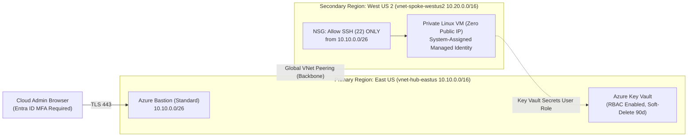

# Lab 3 (Microsoft Azure AZ-104): Explain It Simply & Interview Guide

## 1. Your 30-Second Plain-English Pitch (For Interviews & Clients)
> *"I engineered a multi-region Azure Hub-and-Spoke architecture in **Bicep** spanning `eastus` and `westus2` connected via Global VNet Peering. To eliminate public attack surface, the Linux workload VM in `westus2` has **zero public IP addresses** and sits behind a strict Network Security Group that only accepts SSH traffic from **Azure Bastion** in the Hub VNet over TLS 443. Finally, I enabled a **System-Assigned Managed Identity** on the VM with least-privilege RBAC (`Key Vault Secrets User`) to pull database connection strings from **Azure Key Vault**, and enforced **Microsoft Entra ID Conditional Access MFA** across the Azure Resource Manager control plane."*

---

## 2. Visual Architecture Diagram

---

## 3. Component-by-Component Breakdown

| File | What It Does in Plain English | Why Hiring Managers & Clients Care |
| :--- | :--- | :--- |
| [`main.bicep`](./main.bicep) | Declarative Azure Bicep template provisioning Hub/Spoke VNets, Global Peering, NSG, Bastion, Private VM, Key Vault, and RBAC roles. | Bicep is Microsoft's modern replacement for verbose ARM JSON templates—writing clean Bicep proves real Azure engineering maturity. |
| [`configure-entra-and-secrets.sh`](./configure-entra-and-secrets.sh) | Deploys the stack, injects secrets into Key Vault, and creates an Entra ID Conditional Access MFA policy via Microsoft Graph API. | Shows you secure both the **network plane** (Bastion/NSG) and the **identity plane** (Entra ID Conditional Access + Managed Identity). |
| [`template-variables.json`](./template-variables.json) | Reusable parameters for regions, CIDR blocks, and VM SKUs. | Makes the Hub-Spoke landing zone immediately reusable across client subscriptions. |

---

## 4. Top 3 Technical Interview Questions & Ready Answers

1. **Q: Why did you use Azure Key Vault with RBAC (`enableRbacAuthorization: true`) instead of legacy Key Vault Access Policies?**
   - **A:** *"Legacy Vault Access Policies are an all-or-nothing permission model at the vault level and don't integrate cleanly with Azure PIM or granular scope inheritance. Enabling Azure RBAC lets me assign `Key Vault Secrets Officer` to administrators while granting the VM's System-Assigned Managed Identity the read-only `Key Vault Secrets User` role (`4633458b-17de-408a-b874-0445c86b69e6`) following strict least privilege."*
2. **Q: Why must both `peer-hub-to-spoke` and `peer-spoke-to-hub` resources be created in Bicep for Global VNet Peering?**
   - **A:** *"In Azure, VNet peering is a two-way handshake—each VNet must explicitly declare a peering link pointing to the remote VNet's resource ID before the peering status transitions from `Initiated` to `Connected`."*
3. **Q: How does the administrator SSH into the `westus2` VM if it has no public IP address and lives in a different region from Azure Bastion?**
   - **A:** *"Azure Bastion Standard SKU supports peering across Global VNet Peering. The admin authenticates to the Azure Portal with Entra ID MFA over HTTPS (port 443), connects to the Bastion host in `eastus` (`10.10.0.0/26`), and Bastion tunnels the SSH session privately across the Microsoft backbone to `10.20.1.0/24` in `westus2`, where the NSG explicitly permits port 22 only from `10.10.0.0/26`."*

---

## 5. Quick 10-Minute Review Checklist
- **Sun–Wed Evening (5-Minute Bite-Sized Check):**
  1. Run [`validate-lab.ps1`](./validate-lab.ps1) to verify all 7 Azure Bicep and Zero-Trust checks pass.
  2. Read the **30-Second Pitch** and **3 Interview Q&As** above.
- **Thu–Sat Off-Day (Optional Hands-On Azure CLI Drill):**
  1. Run `az bicep build --file main.bicep` locally to inspect compiled ARM output, or deploy into a test Azure subscription and tear down via `az group delete --name rg-az104-hybrid-lab --yes`.
