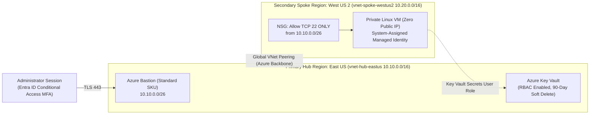

# Module 03 (Microsoft Azure AZ-104): Multi-Region Hub-Spoke Landing Zone with Azure Bastion & Key Vault RBAC

**Required Notice:** Copyright (c) 2026 Adam Dryden (`Phlotonic`) — Dual-Licensed under PolyForm Noncommercial 1.0.0 & Commercial License.

## 1. Executive Architecture Summary
This module provisions a multi-region Azure Hub-and-Spoke landing zone in **Bicep** spanning `eastus` (Hub) and `westus2` (Spoke) connected via bidirectional Global VNet Peering. To eliminate public IP exposure on compute workloads, the Linux VM in `westus2` is deployed with **zero public IP addresses** behind a restrictive Network Security Group (NSG) that permits inbound SSH (`TCP 22`) exclusively from the **Azure Bastion Standard** subnet (`10.10.0.0/26`) in the Hub VNet. Operational secrets are stored in **Azure Key Vault** using role-based access control (`enableRbacAuthorization: true`) and consumed via a **System-Assigned Managed Identity**, while administrative access to Azure Resource Manager is protected by **Microsoft Entra ID Conditional Access MFA**.

---

## 2. Multi-Region Hub-Spoke Topology



---

## 3. Component & Configuration Specification

| Artifact | Functional Role | Production Engineering Rationale |
| :--- | :--- | :--- |
| [`main.bicep`](./main.bicep) | Declarative Azure Bicep template provisioning Hub/Spoke VNets, Global Peering, NSG, Azure Bastion, Private VM, Key Vault, and RBAC role assignments. | Enforces repeatable multi-region infrastructure deployment with compile-time type safety and idempotent resource definitions. |
| [`configure-entra-and-secrets.sh`](./configure-entra-and-secrets.sh) | Deployment orchestrator that provisions the Bicep stack, injects connection strings into Key Vault, and creates an Entra ID Conditional Access MFA policy via Microsoft Graph. | Secures both the network data plane (Bastion + NSG) and the identity control plane (Conditional Access + Managed Identity). |
| [`template-variables.json`](./template-variables.json) | Parameterized configuration for Azure regions, VNet address spaces, and VM SKUs. | Enables rapid adaptation across enterprise subscriptions and regional topologies. |

---

## 4. Key Architectural Design Decisions

1. **Why is Azure Key Vault configured with Azure RBAC (`enableRbacAuthorization: true`) rather than legacy Vault Access Policies?**
   - Azure RBAC provides granular, scope-Aware access control integrated with Privileged Identity Management (PIM). Administrators receive `Key Vault Secrets Officer` (`b86a8fe4-44ce-4948-aee5-eccb2c155cd7`), whereas the workload VM's System-Assigned Managed Identity is restricted to the read-only `Key Vault Secrets User` role (`4633458b-17de-408a-b874-0445c86b69e6`).
2. **Why must both `peer-hub-to-spoke` and `peer-spoke-to-hub` resources be explicitly declared in Bicep?**
   - Azure VNet Peering requires reciprocal resource links from each virtual network to the remote VNet's resource ID before the peering state transitions to `Connected` and routes traffic over the Microsoft backbone.
3. **How is administrative SSH access achieved across regions without assigning a public IP to the Spoke VM?**
   - Azure Bastion Standard SKU supports cross-region connectivity over Global VNet Peering. Administrators authenticate via the Azure Portal over TLS 443 to the Bastion host in `eastus`, which brokers an encrypted SSH session across the peering link to `10.20.1.0/24` in `westus2`.

---

## 5. Deployment & Verification Runbook

```powershell
# 1. Render parameterized Azure landing zone inputs
powershell -NoProfile -ExecutionPolicy Bypass -File .\render-template.ps1

# 2. Execute automated Bicep security, peering & RBAC compliance checks
powershell -NoProfile -ExecutionPolicy Bypass -File .\validate-lab.ps1
```
