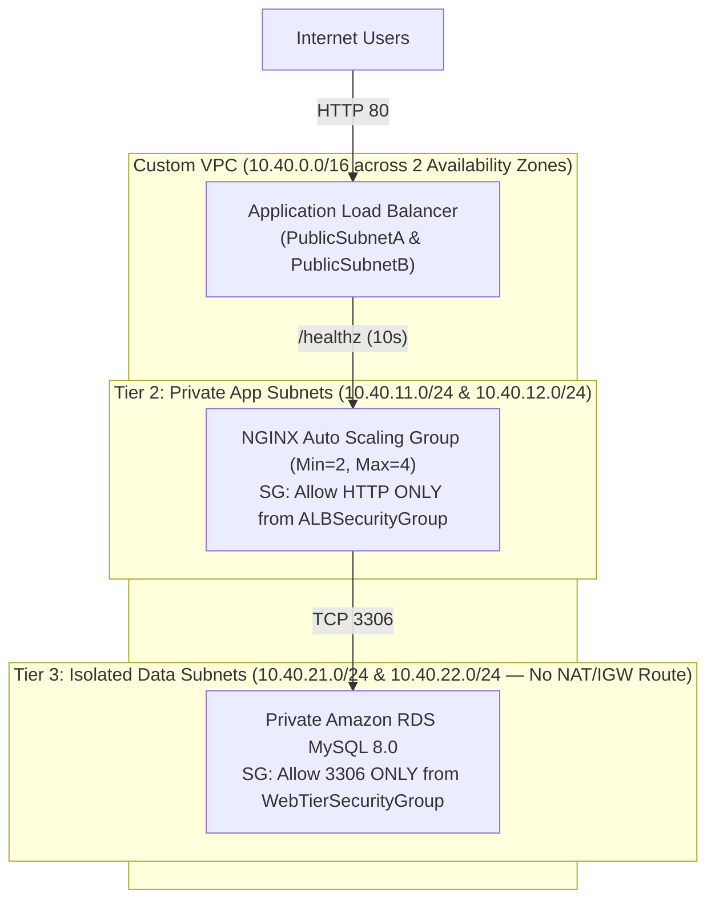

# Lab 4 (AWS SAA-C03): Explain It Simply & Interview Guide

## 1. Your 30-Second Plain-English Pitch (For Interviews & Clients)
> *"I designed a high-availability 3-tier AWS architecture in **CloudFormation** spanning two Availability Zones. Tier 1 holds an internet-facing Application Load Balancer in public subnets; Tier 2 runs private EC2 NGINX servers managed by an **Auto Scaling Group** using `ELB` health checks on `/healthz`; and Tier 3 isolates an **Amazon RDS MySQL** database in private data subnets with zero route to the internet. I chained the Security Groups so each tier only accepts traffic from the Security Group ID of the tier directly above it, and wrote a live chaos script that kills a running EC2 instance while polling the ALB to prove zero-downtime self-healing before tearing down the stack cleanly."*

---

## 2. Visual Architecture Diagram

---

## 3. Component-by-Component Breakdown

| File | What It Does in Plain English | Why Hiring Managers & Clients Care |
| :--- | :--- | :--- |
| [`aws-three-tier-ha.yaml`](./aws-three-tier-ha.yaml) | Complete CloudFormation template creating 6 subnets across 2 AZs, 3 route tables, 3 chained Security Groups, ALB, ASG, and isolated RDS. | Proves you understand the difference between a private subnet with a NAT Gateway route (App Tier, needs `dnf install nginx`) and a truly isolated subnet with local-only routing (Data Tier). |
| [`run-failover-drill.sh`](./run-failover-drill.sh) | Deploys the stack, kills an active EC2 node, probes the ALB 30 times to prove zero dropped requests, and deletes the stack. | Testing failure recovery live (Chaos Engineering) sets you apart from candidates who only draw static diagrams. |
| [`template-variables.json`](./template-variables.json) | Reusable parameters for VPC CIDRs, ASG sizing, and RDS instance classes. | Allows rapid re-deployment across dev, staging, and production accounts. |

---

## 4. Top 3 Technical Interview Questions & Ready Answers

1. **Q: Why did you reference `SourceSecurityGroupId: !Ref ALBSecurityGroup` in `WebTierSecurityGroup` instead of allowing the Public Subnet CIDR blocks (`10.40.1.0/24` and `10.40.2.0/24`)?**
   - **A:** *"Referencing the Security Group ID directly (Security Group chaining) guarantees that only packets originating from the Application Load Balancer itself can reach the EC2 instances on port 80—even if another resource (like a NAT Gateway or bastion host) is placed in those same public subnets."*
2. **Q: Why did you set `HealthCheckType: ELB` instead of the default `EC2` on the Auto Scaling Group?**
   - **A:** *"The default `EC2` health check only checks whether the hypervisor VM is powered on. If NGINX crashes or hangs while the Linux VM is still running, `EC2` health checks won't replace the instance. Setting `HealthCheckType: ELB` forces the Auto Scaling Group to terminate and replace any instance that fails the ALB's HTTP `/healthz` check."*
3. **Q: Why does the Data Tier (`IsolatedDataRouteTable`) have no route to the NAT Gateway?**
   - **A:** *"Amazon RDS is a managed service that AWS patches via its internal control plane, so it never needs outbound internet access. Omitting both the Internet Gateway and NAT Gateway routes from `IsolatedDataRouteTable` guarantees at the routing layer that database traffic cannot exfiltrate to the public internet."*

---

## 5. Quick 10-Minute Review Checklist
- **Sun–Wed Evening (5-Minute Bite-Sized Check):**
  1. Run [`validate-lab.ps1`](./validate-lab.ps1) to verify all 7 AWS CloudFormation and Security Group checks pass.
  2. Review the **30-Second Pitch** and **3 Interview Q&As** above.
- **Thu–Sat Off-Day (Optional Live AWS Failover Drill):**
  1. Run [`run-failover-drill.sh`](./run-failover-drill.sh) in an AWS Free Tier account to capture terminal output of the ASG replacing a terminated instance with zero HTTP downtime.
