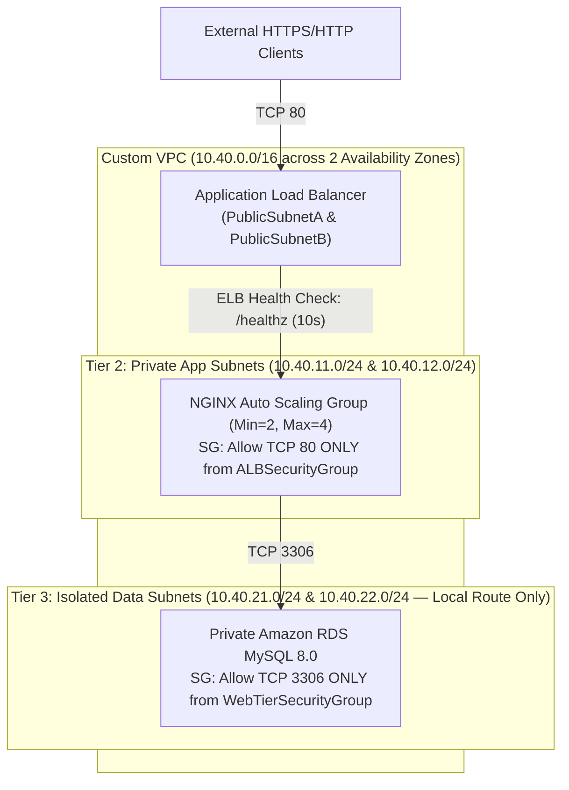

# Module 04 (AWS SAA-C03): High-Availability Three-Tier VPC & Automated Chaos Failover

**Required Notice:** Copyright (c) 2026 Adam Dryden (`Phlotonic`) — Dual-Licensed under PolyForm Noncommercial 1.0.0 & Commercial License.

## 1. Executive Architecture Summary
This module deploys a fault-tolerant, three-tier AWS architecture in **CloudFormation** spanning two Availability Zones. Tier 1 hosts an internet-facing Application Load Balancer (ALB) in public subnets; Tier 2 runs stateless NGINX application servers in private subnets managed by an **EC2 Auto Scaling Group** with `ELB` health checks against `/healthz`; and Tier 3 isolates an **Amazon RDS MySQL 8.0** instance in private data subnets with no route to the internet or NAT Gateway. Security Groups are strictly chained so each tier accepts ingress solely from the Security Group ID of the upstream tier. An accompanying chaos engineering script (`run-failover-drill.sh`) terminates a live EC2 instance while polling the ALB endpoint to verify zero-downtime self-healing recovery.

---

## 2. Multi-AZ Three-Tier Network Topology



---

## 3. Component & Configuration Specification

| Artifact | Functional Role | Production Engineering Rationale |
| :--- | :--- | :--- |
| [`aws-three-tier-ha.yaml`](./aws-three-tier-ha.yaml) | AWS CloudFormation template defining 6 subnets across 2 AZs, 3 route tables, 3 chained Security Groups, ALB, ASG, and isolated RDS. | Segregates workloads that require outbound package updates via NAT Gateway (`PrivateAppRouteTable`) from database storage that must have zero internet routing (`IsolatedDataRouteTable`). |
| [`run-failover-drill.sh`](./run-failover-drill.sh) | Automated chaos failover test and teardown script. | Validates high-availability assumptions empirically by terminating an active EC2 instance and verifying uninterrupted ALB responses and ASG replacement provisioning. |
| [`template-variables.json`](./template-variables.json) | Parameterized configuration for VPC CIDRs, Auto Scaling bounds, and instance classes. | Standardizes environment customization across development, staging, and production AWS accounts. |

---

## 4. FinOps & AWS Cost Optimization Profile

| AWS Resource | Configuration | Estimated Monthly Cost (24x7) | FinOps Optimization Strategy |
| :--- | :--- | :--- | :--- |
| **Managed NAT Gateway** | 1x NAT Gateway + EIP (`PublicSubnetA`) | `~\$32.85 / mo` + data (`\$0.045/hr`) | Attach Gateway VPC Endpoints for S3/DynamoDB (`\$0/mo`) and pre-bake AMIs via EC2 Image Builder to eliminate NAT Gateway egress in non-prod. |
| **Application Load Balancer** | Internet-facing ALB (`alb-three-tier-ha`) | `~\$16.40 / mo` + LCU | Consolidate multiple microservices onto a single ALB using host-header and path-based Listener rules. |
| **EC2 ASG + RDS MySQL** | 2x `t3.micro` + 1x `db.t3.micro` (20 GB) | `~\$29.50 / mo` (`\$0` in Free Tier) | Tear down ephemeral test environments automatically via Step 4 of [`run-failover-drill.sh`](./run-failover-drill.sh). |

---

## 5. Deployment & Verification Runbook

```powershell
# 1. Render parameterized CloudFormation configuration
powershell -NoProfile -ExecutionPolicy Bypass -File .\render-template.ps1

# 2. Execute automated 3-tier isolation, Security Group chaining & failover audit
powershell -NoProfile -ExecutionPolicy Bypass -File .\validate-lab.ps1
```
