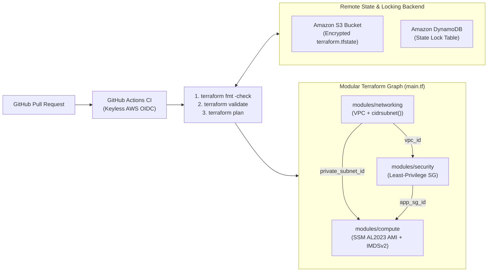

# Lab 5 (HashiCorp Terraform Associate): Explain It Simply & Interview Guide

## 1. Your 30-Second Plain-English Pitch (For Interviews & Clients)
> *"Instead of writing a monolithic Terraform file, I refactored the infrastructure into three reusable child modules—`networking`, `security`, and `compute`—wired together through strongly typed outputs and parameterized via `terraform.tfvars`. To make it safe for multi-engineer teams, I configured encrypted remote state storage in **Amazon S3** with **DynamoDB state locking** to prevent concurrent state corruption, enforced **IMDSv2** on EC2 instances to block SSRF credential theft, and built a **GitHub Actions** pull-request pipeline using keyless **AWS OIDC** authentication to run `terraform fmt`, `validate`, and a speculative `plan` before any code can merge to `main`."*

---

## 2. Visual Architecture Diagram

---

## 3. Component-by-Component Breakdown

| File | What It Does in Plain English | Why Hiring Managers & Clients Care |
| :--- | :--- | :--- |
| [`main.tf`](./main.tf) & [`terraform.tfvars.example`](./terraform.tfvars.example) | Root orchestrator declaring the S3/DynamoDB backend and passing variables into the 3 child modules. | Shows you separate environment configuration (`tfvars`) from reusable infrastructure logic (`modules`). |
| [`modules/networking/main.tf`](./modules/networking/main.tf) | Creates the VPC and calculates subnet CIDRs dynamically with `cidrsubnet(var.vpc_cidr, 8, 10)`. | Using `cidrsubnet()` means a client can change `vpc_cidr` once and all child subnets recalculate automatically without IP math errors. |
| [`modules/compute/main.tf`](./modules/compute/main.tf) | Queries AWS SSM Parameter Store for the latest patched Amazon Linux 2023 AMI and enforces IMDSv2 (`http_tokens = "required"`). | Never hardcodes regional AMI IDs that go stale, and blocks SSRF metadata attacks (like the Capital One breach vector) by requiring session tokens. |
| [`workflows/terraform-pr.yml`](./workflows/terraform-pr.yml) | Automated GitHub Actions workflow using short-lived OIDC tokens (`id-token: write`). | Eliminates long-lived `AWS_ACCESS_KEY_ID` secrets stored in GitHub—the gold standard for modern DevSecOps pipelines. |

---

## 4. Top 3 Technical Interview Questions & Ready Answers

1. **Q: What happens if two DevOps engineers run `terraform apply` at the exact same time against the same environment, and how did you prevent it?**
   - **A:** *"Without state locking, concurrent applies can overwrite `terraform.tfstate` and corrupt or orphan cloud resources. I configured an S3 backend paired with a DynamoDB table (`dynamodb_table = "quanumis-terraform-state-locks"`). Before Terraform modifies state, it acquires a conditional write lock in DynamoDB; the second engineer's run immediately fails with a lock-held message until the first run finishes."*
2. **Q: Why did your GitHub Actions workflow use `aws-actions/configure-aws-credentials@v4` with `role-to-assume` (OIDC) instead of storing AWS IAM access keys in GitHub Secrets?**
   - **A:** *"Static IAM access keys never expire unless manually rotated and are a major leak risk if a repo or CI runner is compromised. With OpenID Connect (OIDC), GitHub Actions exchanges a cryptographically signed JWT with AWS STS to assume an IAM role for a short-lived session (e.g., 15 minutes), so zero static AWS keys ever exist in GitHub."*
3. **Q: How does Terraform know to create `module.networking` and `module.security` before `module.compute` without using `depends_on`?**
   - **A:** *"Terraform builds an implicit dependency graph by analyzing variable references. Because `module.compute` takes `subnet_id = module.networking.private_subnet_id` and `security_group_id = module.security.app_sg_id`, Terraform automatically provisions the VPC, Subnet, and Security Group first and passes their output IDs into the EC2 module."*

---

## 5. Quick 10-Minute Review Checklist
- **Sun–Wed Evening (5-Minute Bite-Sized Check):**
  1. Run [`validate-lab.ps1`](./validate-lab.ps1) to verify all 7 modular Terraform and CI checks pass.
  2. Read the **30-Second Pitch** and **3 Interview Q&As** above.
- **Thu–Sat Off-Day (Optional Local Terraform CLI Check):**
  1. Run `terraform fmt -check -recursive` and `terraform init -backend=false && terraform validate` inside `05-terraform-modular-pipeline`.
