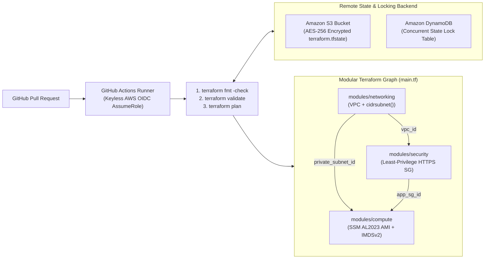

# Module 05 (HashiCorp Terraform Associate): Multi-Module IaC Pipeline with S3/DynamoDB State Locking & Keyless OIDC CI

**Required Notice:** Copyright (c) 2026 Adam Dryden (`Phlotonic`) — Dual-Licensed under PolyForm Noncommercial 1.0.0 & Commercial License.

## 1. Executive Architecture Summary
This module implements a modular **HashiCorp Terraform** architecture paired with an automated **GitHub Actions** pull-request validation pipeline. Infrastructure resources are decoupled into three reusable child modules—`networking`, `security`, and `compute`—wired via strongly typed outputs and parameterized through `terraform.tfvars`. Concurrent state corruption is prevented using an encrypted **Amazon S3** remote backend with **DynamoDB state locking**. Compute instances resolve the latest patched Amazon Linux 2023 AMI dynamically via AWS SSM Parameter Store and enforce **IMDSv2** (`http_tokens = "required"`), while the CI pipeline authenticates via short-lived **AWS OIDC** tokens to execute `terraform fmt`, `validate`, and speculative `plan` checks on every pull request.

---

## 2. CI/CD & Module Dependency Architecture



---

## 3. Component & Configuration Specification

| Artifact | Functional Role | Production Engineering Rationale |
| :--- | :--- | :--- |
| [`main.tf`](./main.tf) & [`terraform.tfvars.example`](./terraform.tfvars.example) | Root module configuring the S3/DynamoDB backend and composing the three child modules. | Separates environment-specific inputs (`tfvars`) from reusable infrastructure definitions (`modules/*`). |
| [`modules/networking/main.tf`](./modules/networking/main.tf) | Provisions the VPC and computes child subnet CIDRs dynamically via `cidrsubnet(var.vpc_cidr, 8, 10)`. | Eliminates manual subnet CIDR collisions when deploying across multiple environments. |
| [`modules/compute/main.tf`](./modules/compute/main.tf) | Queries AWS SSM Parameter Store for the latest Amazon Linux 2023 AMI and enforces IMDSv2 (`http_tokens = "required"`). | Avoids hardcoded regional AMI IDs and mitigates SSRF instance metadata credential theft vectors. |
| [`workflows/terraform-pr.yml`](./workflows/terraform-pr.yml) | GitHub Actions workflow using `aws-actions/configure-aws-credentials@v4` with OIDC (`id-token: write`). | Eliminates static, long-lived AWS IAM access keys stored in CI secrets. |

---

## 4. FinOps & State Backend Cost Profile

| Component | Configuration | Estimated Monthly Cost | FinOps Optimization Strategy |
| :--- | :--- | :--- | :--- |
| **S3 + DynamoDB State Backend** | S3 Standard + DynamoDB `PAY_PER_REQUEST` | **< \$0.10 / mo** | Use DynamoDB On-Demand (`PAY_PER_REQUEST`) for state lock tables so idle periods incur \$0.00 in provisioned RCU/WCU charges. |
| **Compute Module (`aws_instance`)** | 1x `t3.micro` (`al2023-ami`) | `~\$7.59 / mo` (`\$0` Free Tier) | Switch `instance_type` to Graviton (`t4g.micro`) for 20% lower compute cost where x86_64 binaries are not required. |

---

## 5. Deployment & Verification Runbook

```powershell
# 1. Render parameterized Terraform inputs
powershell -NoProfile -ExecutionPolicy Bypass -File .\render-template.ps1

# 2. Execute automated module structure, state lock, IMDSv2 & CI workflow validation
powershell -NoProfile -ExecutionPolicy Bypass -File .\validate-lab.ps1
```
