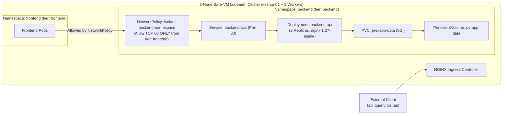

# Lab 6 (Certified Kubernetes Administrator — CKA): Explain It Simply & Interview Guide

## 1. Your 30-Second Plain-English Pitch (For Interviews & Clients)
> *"Instead of relying on a managed cloud button like EKS or AKS, I bootstrapped a 3-node bare-VM Kubernetes v1.31 cluster from scratch using **`kubeadm`** and **`containerd`** with `SystemdCgroup = true`. I installed **Calico CNI** so I could enforce zero-trust **`NetworkPolicy`** rules that lock down the `backend` namespace so it only accepts TCP port 80 traffic from pods in the `frontend` namespace, backed by a 5Gi `PersistentVolume` and NGINX `Ingress`. Finally, I executed and documented three live chaos recovery drills—fixing a corrupted `kube-apiserver` static pod manifest with `crictl`, repairing a broken `kubelet` systemd unit (`status=203/EXEC`), and rotating expired cluster PKI certificates via `kubeadm certs renew all`."*

---

## 2. Visual Architecture Diagram

---

## 3. Component-by-Component Breakdown

| File | What It Does in Plain English | Why Hiring Managers & Clients Care |
| :--- | :--- | :--- |
| [`bootstrap-kubeadm.sh`](./bootstrap-kubeadm.sh) | Configures Linux kernel modules (`overlay`, `br_netfilter`), `containerd` (`SystemdCgroup = true`), `kubeadm init`, Calico CNI, and NGINX Ingress. | Most engineers fail when `kubelet` crashes because `containerd` defaults to `cgroupfs` while `kubeadm` uses `systemd`—fixing `SystemdCgroup = true` proves real bare-metal experience. |
| [`cluster-workloads.yaml`](./cluster-workloads.yaml) | Deploys namespaces, 5Gi PV/PVC storage, 2-replica deployment, Service, Ingress, and a zero-trust `NetworkPolicy`. | By default, Kubernetes allows all pods to talk to all other pods across namespaces; adding a `NetworkPolicy` enforces micro-segmentation. |
| [`CKA-Break-Fix-Runbook.md`](./CKA-Break-Fix-Runbook.md) | Step-by-step diagnosis and recovery commands for control-plane static pod crashes, `kubelet` systemd failures, and expired TLS certificates. | Directly mirrors both the live terminal tasks on the CKA exam and real 3:00 AM production SRE on-call incidents. |

---

## 4. Top 3 Technical Interview Questions & Ready Answers

1. **Q: If `kube-apiserver` is down and `kubectl` returns `connection refused`, how do you inspect the container logs on the control plane node?**
   - **A:** *"Because `kubectl logs` talks to `kube-apiserver`, `kubectl` is useless when the API server itself is down. Instead, I SSH into the control plane node and use the CRI CLI tool directly against `containerd`: `sudo crictl ps -a | grep kube-apiserver` to find the exited container ID, then `sudo crictl logs <CONTAINER_ID>` to read the crash reason, and fix the static pod manifest in `/etc/kubernetes/manifests/kube-apiserver.yaml`."*
2. **Q: Why did you install Calico CNI instead of Flannel for this cluster?**
   - **A:** *"Standard Flannel only provides basic Layer 3 overlay routing and does not enforce Kubernetes `NetworkPolicy` objects. If you apply a `NetworkPolicy` on a Flannel cluster, Kubernetes silently accepts the YAML without filtering any traffic. Calico programs Linux `iptables`/eBPF rules to actively enforce `isolate-backend-namespace`."*
3. **Q: Why is `SystemdCgroup = true` critical in `/etc/containerd/config.toml`?**
   - **A:** *"Modern Linux distributions (like Ubuntu 24.04 with cgroups v2) and `kubelet` use `systemd` as the cgroup driver by default. However, `containerd config default` generates `SystemdCgroup = false` (`cgroupfs`). Running two different cgroup drivers on the same node causes resource accounting splits and `kubelet` instability under load."*

---

## 5. Quick 10-Minute Review Checklist
- **Sun–Wed Evening (5-Minute Bite-Sized Check):**
  1. Run [`validate-lab.ps1`](./validate-lab.ps1) to verify all 7 Kubernetes CKA and chaos runbook checks pass.
  2. Read the **30-Second Pitch**, [`CKA-Break-Fix-Runbook.md`](./CKA-Break-Fix-Runbook.md), and the **3 Interview Q&As** above.
- **Thu–Sat Off-Day (Optional Multipass / Bare-VM Cluster Drill):**
  1. Spin up 3 Ubuntu VMs and run [`bootstrap-kubeadm.sh`](./bootstrap-kubeadm.sh) + [`cluster-workloads.yaml`](./cluster-workloads.yaml), then practice the 3 break/fix drills in [`CKA-Break-Fix-Runbook.md`](./CKA-Break-Fix-Runbook.md).
