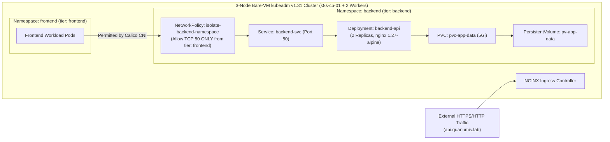

# Module 06 (Certified Kubernetes Administrator — CKA): Bare-Metal `kubeadm` Cluster, Zero-Trust NetworkPolicies & Chaos Recovery Runbook

**Required Notice:** Copyright (c) 2026 Adam Dryden (`Phlotonic`) — Dual-Licensed under PolyForm Noncommercial 1.0.0 & Commercial License.

## 1. Executive Architecture Summary
This module bootstraps a production-grade, three-node Kubernetes v1.31 cluster (`k8s-cp-01`, `k8s-worker-01`, `k8s-worker-02`) on bare Linux VMs using **`kubeadm`** and **`containerd`** configured with `SystemdCgroup = true`. Cluster networking is powered by **Calico CNI** to enforce zero-trust **`NetworkPolicy`** micro-segmentation (`isolate-backend-namespace`), restricting TCP port 80 ingress on the `backend` namespace exclusively to pods labeled `tier: frontend`, backed by a 5Gi `PersistentVolume` and bare-metal **NGINX Ingress Controller**. Accompanied by a comprehensive **CKA Break/Fix Runbook**, the module documents live diagnosis and recovery procedures for control-plane static pod failures (`crictl`), broken `kubelet` systemd units (`status=203/EXEC`), and expired cluster PKI certificates (`kubeadm certs renew all`).

---

## 2. Cluster & Zero-Trust Micro-Segmentation Topology



---

## 3. Component & Configuration Specification

| Artifact | Functional Role | Production Engineering Rationale |
| :--- | :--- | :--- |
| [`bootstrap-kubeadm.sh`](./bootstrap-kubeadm.sh) | Node preparation and cluster bootstrap script configuring kernel modules (`overlay`, `br_netfilter`), `containerd` (`SystemdCgroup = true`), `kubeadm init`, Calico CNI, and NGINX Ingress. | Aligns the container runtime and `kubelet` on the `systemd` cgroup v2 driver to prevent resource accounting splits and node instability under load. |
| [`cluster-workloads.yaml`](./cluster-workloads.yaml) | Declarative manifests for namespaces, 5Gi PV/PVC storage, 2-replica deployment, Service, Ingress, and zero-trust `NetworkPolicy`. | Replaces Kubernetes' default flat pod-to-pod network behavior with explicit namespace-to-namespace ingress whitelisting. |
| [`CKA-Break-Fix-Runbook.md`](./CKA-Break-Fix-Runbook.md) | Incident recovery runbook covering API server static pod corruption, `kubelet` systemd misconfiguration, and PKI certificate expiration. | Provides deterministic out-of-band recovery commands (`crictl`, `journalctl`, `kubeadm certs`) when the Kubernetes API server itself is unreachable. |

---

## 4. FinOps & Cluster Infrastructure Cost Profile

| Environment Target | Node Specification | Control-Plane Management Fee | FinOps Advantage vs. Managed K8s (EKS/AKS/GKE) |
| :--- | :--- | :--- | :--- |
| **Bare-VM / Multipass / Proxmox** | 3x Ubuntu 24.04 VMs (2 vCPU / 4 GB RAM each) | **\$0.00 / mo** | Avoids the `\$73.00/mo` (`\$0.10/hr`) per-cluster EKS/AKS/GKE control-plane fee for dev/staging and edge clusters. |

---

## 5. Deployment & Verification Runbook

```powershell
# 1. Render parameterized Kubernetes cluster configuration
powershell -NoProfile -ExecutionPolicy Bypass -File .\render-template.ps1

# 2. Execute automated CKA bootstrap, NetworkPolicy & chaos runbook validation
powershell -NoProfile -ExecutionPolicy Bypass -File .\validate-lab.ps1
```
