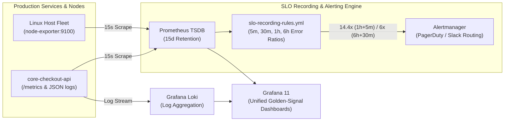

# Module 07 (SRE Platform Engineering): Full-Stack Golden-Signal Observability & Multi-Window SLO Burn-Rate Alerting

**Required Notice:** Copyright (c) 2026 Adam Dryden (`Phlotonic`) — Dual-Licensed under PolyForm Noncommercial 1.0.0 & Commercial License.

## 1. Executive Architecture Summary
This module implements an enterprise Site Reliability Engineering (SRE) observability stack built on **Prometheus**, **Alertmanager**, **Grafana**, and **Grafana Loki**. Rather than alerting on noisy raw CPU spikes or isolated HTTP 500 errors that cause on-call alert fatigue, the pipeline pre-computes the **Four Golden Signals** (Latency `p99`, Traffic RPS, Error Ratio, and Memory/CPU Saturation) via Prometheus recording rules and enforces **Google SRE multi-window, multi-burn-rate Service Level Objective (SLO) alerts** targeting `99.9%` availability (`43.2 minutes` monthly error budget). Fast-burn outages (`14.4x` burn rate across both `1h` and `5m` windows) trigger immediate paging, whereas slow-burn degradations (`6.0x` burn rate across `6h` and `30m` windows) open remediation tickets.

---

## 2. Observability & Multi-Window SLO Pipeline



---

## 3. Component & Configuration Specification

| Artifact | Functional Role | Production Engineering Rationale |
| :--- | :--- | :--- |
| [`prometheus.yml`](./prometheus.yml) | Prometheus scrape, rule evaluation, and Alertmanager target configuration. | Standardizes `15s` scrape/evaluation intervals and attaches cluster/service external labels for federated querying. |
| [`slo-recording-rules.yml`](./slo-recording-rules.yml) | Pre-computed Golden Signal recording rules and multi-window SLO burn-rate alerts. | Requiring both a long window (`1h`) and a short confirmation window (`5m`) to exceed `14.4x` error-budget burn guarantees immediate reset detection once an incident is mitigated. |
| [`docker-compose-observability.yml`](./docker-compose-observability.yml) | Declarative container stack deploying Prometheus, Alertmanager, Loki, and Grafana. | Provides a self-contained observability control plane with bounded `15d` TSDB retention. |

---

## 4. FinOps & Telemetry Cost Profile

| Stack Option | Monthly Ingestion (50 Nodes / 200M Active Series) | Estimated Monthly Cost | FinOps Optimization Strategy |
| :--- | :--- | :--- | :--- |
| **Self-Hosted Prometheus + Loki (This Blueprint)** | 1x `t3.large` + 100 GB GP3 EBS + S3 Chunk Storage | **~\$76.00 / mo** | Evaluating `job:` recording rules before dashboard queries reduces cardinality and saves **80–90%** compared to commercial SaaS per-host/per-custom-metric pricing (`\$1,200+/mo`). |

---

## 5. Deployment & Verification Runbook

```powershell
# 1. Render parameterized service & SLO targets
powershell -NoProfile -ExecutionPolicy Bypass -File .\render-template.ps1

# 2. Execute automated Golden-Signal & multi-window SLO compliance checks
powershell -NoProfile -ExecutionPolicy Bypass -File .\validate-lab.ps1
```
