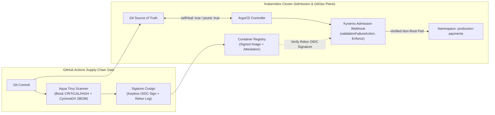

# Module 08 (CKS & GitOps): DevSecOps Software Supply-Chain Security, ArgoCD & Kyverno Admission Control

**Required Notice:** Copyright (c) 2026 Adam Dryden (`Phlotonic`) — Dual-Licensed under PolyForm Noncommercial 1.0.0 & Commercial License.

## 1. Executive Architecture Summary
This module implements a zero-trust software supply-chain and **Certified Kubernetes Security Specialist (CKS)** enforcement pipeline. In Continuous Integration, **Aqua Trivy** scans manifests and container filesystems, failing builds on any `CRITICAL` or `HIGH` CVE while emitting a **CycloneDX Software Bill of Materials (SBOM)**, followed by keyless OIDC cryptographic signing via **Sigstore Cosign** recorded to the immutable Rekor transparency log. In Continuous Deployment, **ArgoCD** reconciles cluster state declaratively from Git (`selfHeal: true`, `prune: true`), while **Kyverno** validating admission webhooks (`validationFailureAction: Enforce`) reject any Pod that lacks a valid Cosign OIDC signature, requests `privileged: true`, allows privilege escalation, or fails to drop `ALL` Linux kernel capabilities.

---

## 2. Supply-Chain & Admission Control Architecture



---

## 3. Component & Configuration Specification

| Artifact | Functional Role | Production Engineering Rationale |
| :--- | :--- | :--- |
| [`argocd-application.yaml`](./argocd-application.yaml) | Declarative ArgoCD `Application` manifest with automated self-healing and pruning. | Automatically reverts unauthorized manual `kubectl edit` drift in the cluster back to the audited Git state within seconds. |
| [`kyverno-cluster-policies.yaml`](./kyverno-cluster-policies.yaml) | Kyverno `ClusterPolicy` manifests enforcing Pod Security Standards and Sigstore Cosign image verification. | Blocks compromised or unsigned images and prevents container breakout via `readOnlyRootFilesystem: true` and `drop: [ALL]`. |
| [`supply-chain-ci.yml`](./supply-chain-ci.yml) | GitHub Actions pipeline executing Trivy vulnerability gating, CycloneDX SBOM export, and Cosign signing. | Satisfies Executive Order 14028 / SLSA supply-chain provenance requirements without managing static signing keys. |

---

## 4. FinOps & Supply-Chain Tooling Cost Profile

| Tooling Stack | Licensing Model | Estimated Monthly Cost | FinOps Advantage |
| :--- | :--- | :--- | :--- |
| **ArgoCD + Kyverno + Trivy + Sigstore Cosign** | CNCF / Open-Source | **\$0.00 / mo** | Replaces commercial admission/scanner suites (`\$150–\$300/node/yr`) with CNCF-graduated zero-cost admission and signing primitives. |

---

## 5. Deployment & Verification Runbook

```powershell
# 1. Render parameterized ArgoCD & Kyverno manifests
powershell -NoProfile -ExecutionPolicy Bypass -File .\render-template.ps1

# 2. Execute automated CKS admission, GitOps & supply-chain compliance checks
powershell -NoProfile -ExecutionPolicy Bypass -File .\validate-lab.ps1
```
