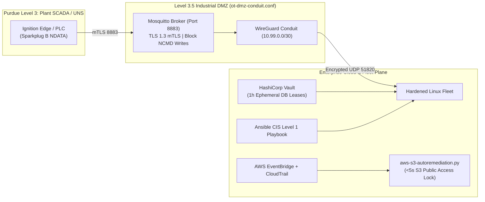

# Module 09 (Zero-Trust SecOps & Industrial Edge): Ansible CIS Hardening, HashiCorp Vault Dynamic Secrets, Cloud Auto-Remediation & IEC 62443 IT/OT Conduit

**Required Notice:** Copyright (c) 2026 Adam Dryden (`Phlotonic`) — Dual-Licensed under PolyForm Noncommercial 1.0.0 & Commercial License.

## 1. Executive Architecture Summary
This module unifies four advanced security automation patterns across Linux fleets, dynamic secret management, serverless cloud posture remediation, and industrial OT/IT edge boundaries:
1. **CIS Level 1 Fleet Hardening (`ansible-cis-hardening.yml`):** Idempotent **Ansible** automation disabling SSH root/password authentication, enabling kernel ASLR (`randomize_va_space = 2`) and SYN cookies, and injecting short-lived credentials at runtime.
2. **Ephemeral Database Secrets (`vault-dynamic-db.hcl`):** **HashiCorp Vault** database secrets engine generating unique, read-only SQL roles per workload with a `1h` default TTL (`max_ttl = 24h`) that self-destruct upon lease expiration.
3. **Sub-5-Second Cloud Auto-Remediation (`aws-s3-autoremediation.py`):** Event-driven **AWS EventBridge + Lambda** workflow that intercepts CloudTrail S3 ACL/policy modifications and immediately restores `PublicAccessBlockConfiguration`.
4. **IEC 62443 Level 3.5 IT/OT DMZ Conduit (`ot-dmz-conduit.conf`):** Encrypted **WireGuard** point-to-point tunnel (`10.99.0.0/30`) paired with a **TLS 1.3 mutual-TLS (mTLS) Mosquitto MQTT broker** that permits read-only Sparkplug B (`NDATA`) telemetry egress from plant networks while blocking inbound cloud-to-PLC command writes (`NCMD`).

---

## 2. Zero-Trust SecOps & IT/OT Conduit Architecture



---

## 3. Component & Configuration Specification

| Artifact | Functional Role | Production Engineering Rationale |
| :--- | :--- | :--- |
| [`ansible-cis-hardening.yml`](./ansible-cis-hardening.yml) | Ansible playbook enforcing CIS Linux benchmarks and pulling dynamic Vault leases. | Eliminates configuration drift across Linux hosts and prevents cleartext credential storage on disk (`no_log: true`). |
| [`vault-dynamic-db.hcl`](./vault-dynamic-db.hcl) | HashiCorp Vault policy and dynamic SQL role configuration (`default_ttl = "1h"`). | Eliminates shared static database passwords; compromised credentials expire automatically within 60 minutes. |
| [`aws-s3-autoremediation.py`](./aws-s3-autoremediation.py) | Python 3.12 AWS Lambda handler triggered by CloudTrail S3 permission events. | Reduces Mean Time to Remediate (MTTR) for accidental public S3 bucket exposure from hours/days to under 5 seconds. |
| [`ot-dmz-conduit.conf`](./ot-dmz-conduit.conf) | WireGuard + Mosquitto TLS 1.3 mTLS configuration for IEC 62443 Level 3.5 IDMZ. | Bridges OT Unified Namespace (UNS) telemetry to cloud analytics while enforcing strict unidirectional command isolation. |

---

## 4. FinOps & Security Automation Cost Profile

| Capability | Cloud / Infrastructure Footprint | Estimated Monthly Cost | FinOps Advantage |
| :--- | :--- | :--- | :--- |
| **EventBridge + Lambda S3 Auto-Remediation** | Serverless event-driven invocation (`<1,000 events/mo`) | **\$0.00 / mo** (AWS Free Tier) | Replaces expensive third-party CSPM seats (`\$25–\$50/cloud-account/mo`) for core storage and IAM guardrails. |
| **Ansible + Vault OSS + WireGuard/Mosquitto** | Self-hosted on existing management / IDMZ nodes | **\$0.00 / mo** | Zero per-node configuration management or VPN gateway licensing fees. |

---

## 5. Deployment & Verification Runbook

```powershell
# 1. Render parameterized Vault TTL & IEC 62443 conduit settings
powershell -NoProfile -ExecutionPolicy Bypass -File .\render-template.ps1

# 2. Execute automated CIS, Vault, CSPM & OT conduit compliance checks
powershell -NoProfile -ExecutionPolicy Bypass -File .\validate-lab.ps1
```
